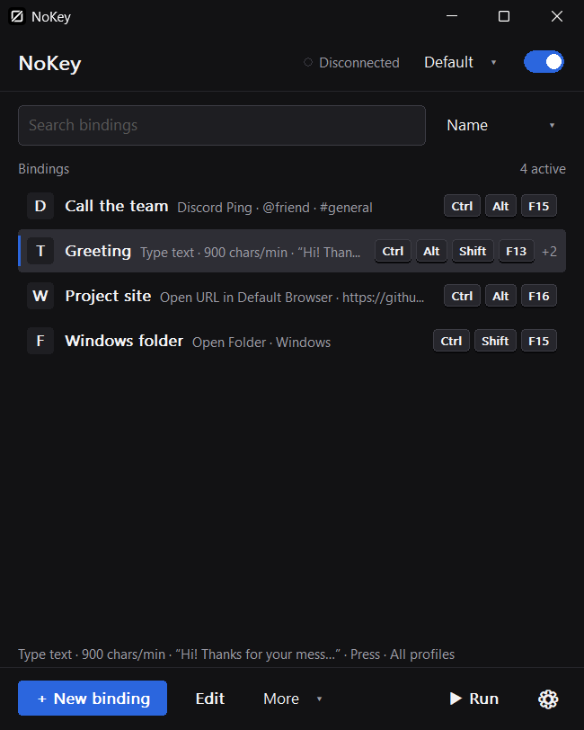
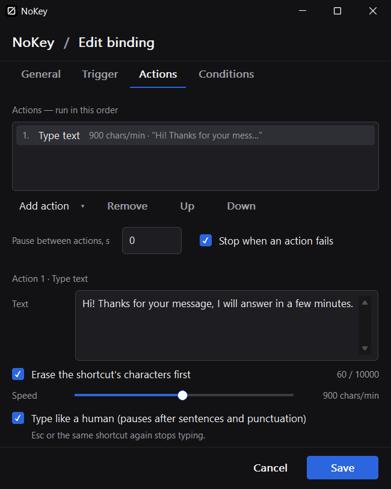
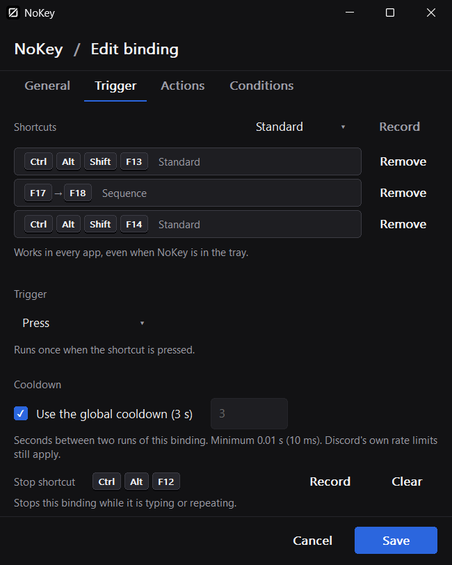
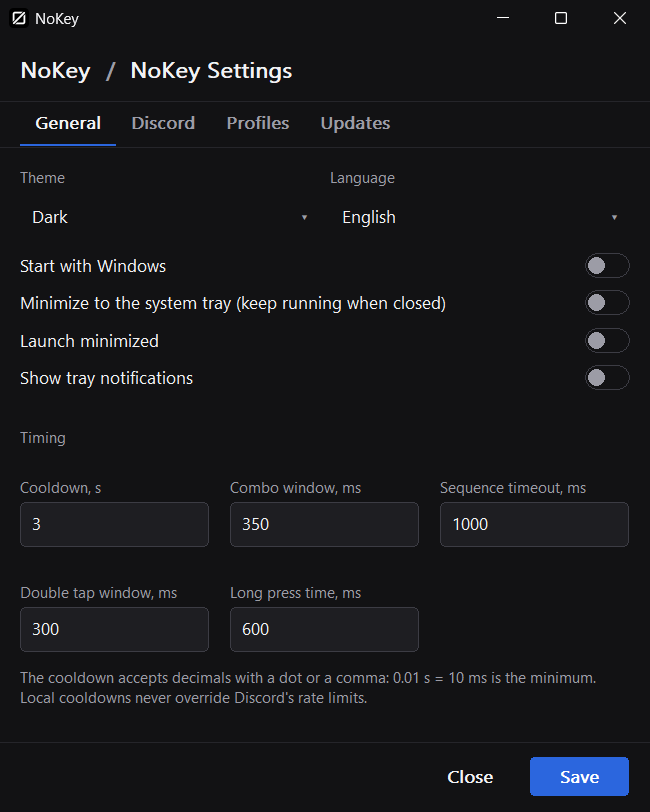
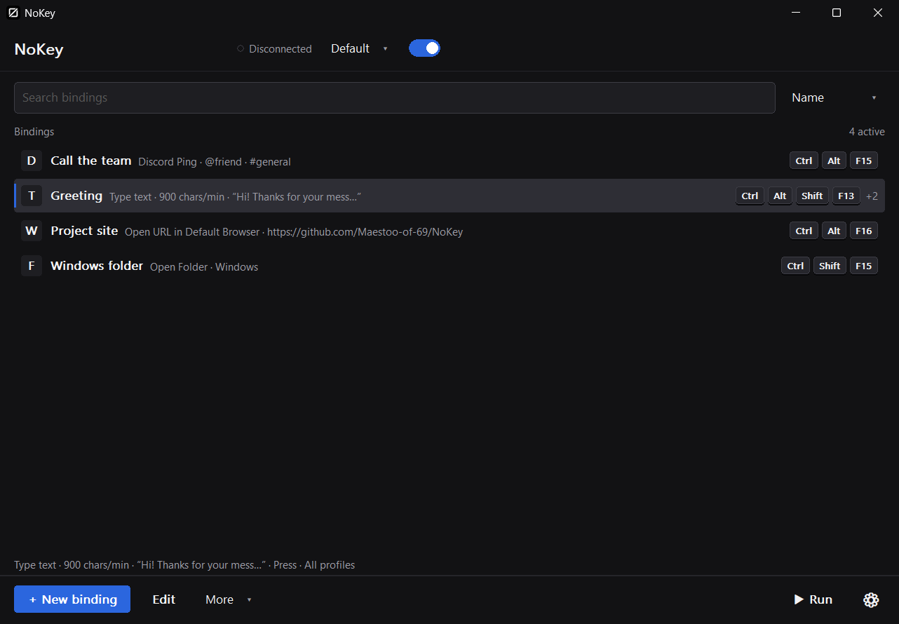

# NoKey

**A small, native hotkey manager for Windows.** Press a shortcut and NoKey
types a saved text, mentions someone in Discord, opens an app, a file, a
folder or a website, or does several of these in a row.

**English** · [Русский](README.ru.md)

[**⬇ Download NoKey.exe**](https://github.com/Maestoo-of-69/NoKey/releases/latest/download/NoKey.exe)
· [What's new in 1.0](https://github.com/Maestoo-of-69/NoKey/releases/tag/v1.0.0)
· [All releases](https://github.com/Maestoo-of-69/NoKey/releases)

Windows 10 / 11, 64-bit. macOS and Linux are not supported yet.

<p>
  
  
</p>

## Why NoKey

- **One portable file** of under 1 MB. No installer, no Electron, WebView or
  .NET runtime: plain Rust and Win32.
- **Quiet.** Lives in the system tray, reacts to events instead of polling, and
  has no telemetry or cloud.
- **One window.** It starts narrow, stretches or maximizes when you need room,
  and every page follows.
- **Looks how you like.** 5 themes and 4 interface languages, including Hebrew
  with a mirrored right-to-left layout.

## Quick start

1. Download `NoKey.exe` and put it in any folder, for example `C:\Tools\NoKey\`.
2. Double-click it. The exe is not code-signed, so Windows may warn you:
   - **SmartScreen** ("Windows protected your PC"): **More info → Run anyway**.
   - **Smart App Control** may block it with no "Run anyway" button. Then
     build it yourself (see [Build and test](#build-and-test)) or turn Smart
     App Control off.
3. NoKey appears in the system tray (the `^` area next to the clock).
   Double-click the icon, press **+ New binding**, record a shortcut, pick an
   action and save.
4. Discord mentions need your own bot first: see [SETUP.md](SETUP.md).

Optional: check the download (PowerShell, in the download folder) against
[`NoKey.exe.sha256`](https://github.com/Maestoo-of-69/NoKey/releases/latest/download/NoKey.exe.sha256):

```powershell
(Get-FileHash .\NoKey.exe -Algorithm SHA256).Hash
```

**Update:** Settings → Updates → **Check for updates**, or replace the exe.
Settings are kept. **Remove:** tray icon → **Exit**, then delete the exe and
the `%APPDATA%\NoKey` folder.

## Actions

| Action | What it does |
|--------|--------------|
| **Type text** | Types your text into the active window, at your speed. |
| **Discord mention** | Sends one message `<@user>` through your bot. Only that user is pinged, never `@everyone`, `@here` or roles. |
| **Open application** | An `.exe` / `.lnk`, or a game shortcut `.url` such as Steam's `steam://rungameid/570`. Command shells and script hosts are refused. |
| **Open file / folder** | Programs and scripts are refused as "files". |
| **Open website** | `http(s)://` only, in your default browser. |

A binding can hold up to **10 actions**, run in order, with an optional pause
between them and "stop when an action fails". No action runs shell commands.

### Type text

- Up to 10 000 characters, **30 to 30 000 characters per minute**.
- **Human mode:** uneven rhythm and pauses after punctuation, sentences and
  line breaks. Those pauses have a minimum length, so at high speeds human mode
  is much slower than the setting.
- **Erase the shortcut's characters** (on by default): a shortcut such as
  `1 → 2 → 3` also types into the program, so NoKey sends that many Backspaces
  first. It applies to the first step of a binding started by a shortcut.
- It waits until Ctrl / Alt / Shift / Win are released and pauses while one is
  held. It **stops** on Esc, the same shortcut again, the binding's stop
  shortcut, Ctrl + Alt + Pause, or when you switch windows.
- Limits: at high speeds several characters are sent at once and some programs
  may drop them; keys held long enough to auto-repeat type more than is erased;
  pressing the shortcut again to stop leaves its characters in the text.
  Windows blocks typing into programs run as administrator unless NoKey runs as
  administrator too.

## Shortcuts and triggers

<p>
  
  
</p>

| Type | Examples | How it works |
|------|----------|--------------|
| Standard | `F8`, `Ctrl + Q`, `Ctrl + Shift + P` | `RegisterHotKey` (the keyboard hook for Release, Long Press and Repeat). |
| Simultaneous | `A + S`, `Q + W + E` | Keyboard hook; all keys within the combo window (350 ms by default). |
| Sequence | `A → B`, `Ctrl → K → C` | Keyboard hook; each step within the sequence timeout (1000 ms by default). |

Up to **3 shortcuts** per binding, recorded by pressing them. NoKey warns about
conflicts inside a profile, and a priority from 0 to 9 decides when one key
press matches several bindings. A standard shortcut needs Ctrl, Alt or Win
unless the key does not type anything (F1–F24, Pause, …).

| Trigger mode | Runs |
|--------------|------|
| Press | once when the shortcut goes down |
| Release | once when it is released |
| Double tap | on the second press (300 ms by default) |
| Long press | after holding (600 ms by default) |
| Repeat while held | at once, then every interval while held |
| Toggle repeat | first press starts repeating, the next one stops |

Repeats need at least 0.1 s between runs, stop after 1–1000 runs or at the
first error, and are not allowed for Discord mentions or Type text.

**Stop shortcut.** Give a binding its own key to stop it (for example `F12`).
NoKey holds that key only while the binding is typing or repeating.

## Staying in control

- The **master switch** in the header and the always-on **Ctrl + Alt + Pause**
  emergency switch turn every binding off. Nothing is deleted.
- **Profiles** (Default, Gaming, Work, Discord and your own): only the active
  profile and "All profiles" bindings work. Switch from the window, the tray or
  a shortcut.
- **Conditions** per binding: only in a given program, only when the window
  title contains a text, never in fullscreen apps.
- **Cooldown** per binding or global, 10 ms to 3600 s. Discord's rate limits
  always apply as well.
- Pause one binding for 15 minutes, an hour or until restart.

## Interface

- One window, at least 520 × 620, resizable and maximizable. The editor and
  Settings open inside it; **NoKey** in the top left corner leads back.
- Hover, click, switch and page animations, turned off together with Windows
  "Animation effects".
- Themes: Dark, Light, Contrast, System (follows Windows) and Jewish.
- Languages: English, Русский, עברית and "Язык боли" (a joke Russian).
- Search, sorting, a right-click menu, and an icon, description, sound and
  notification for each binding.



## Files and privacy

| What | Where |
|------|-------|
| Settings and bindings (including texts to type) | `%APPDATA%\NoKey\config.json` |
| Discord bot token | `%APPDATA%\NoKey\token.bin`, encrypted with Windows DPAPI, never shown or logged |
| Backup of an upgraded 0.1 config | `%APPDATA%\NoKey\config.v1-backup-<time>.json` |
| Downloaded updates | `%LOCALAPPDATA%\NoKey\update\` |
| Autostart (only when enabled) | `HKCU\...\CurrentVersion\Run`, value `NoKey` |

`config.json` is plain text: do not put passwords into texts to type. The
keyboard hook keeps keystrokes in memory only to match shortcuts. Network
requests go to Discord (when you use it) and to GitHub (when you check for
updates). `NOKEY_DATA_DIR` moves the data folder (portable use, tests).
Full privacy policy: [PRIVACY.md](PRIVACY.md).

## Known limitations

- Windows only.
- While a program run as administrator is focused, simultaneous and sequence
  shortcuts do not work unless NoKey is elevated too.
- `Ctrl + Alt + Del`, `Win + L` and similar system keys cannot be bound.
- Simultaneous and sequence shortcuts still reach the program; standard ones
  are consumed, even when a condition then skips the binding.
- The Discord target is entered by user ID.
- An `.lnk` in "Open application" runs whatever it points to.

## Build and test

Requirements: Rust stable (MSVC toolchain) and Visual Studio Build Tools with
the Windows SDK.

```powershell
cargo build --release      # → target\release\NoKey.exe
cargo test                 # unit and integration tests
cargo clippy --all-targets
```

The hotkey tests inject F21–F24 with `SendInput`, so keep a normal window (not
an administrator one) in front while they run. Live Discord tests are ignored
by default (`tests/discord_live.rs`).

**Microsoft Store build:** `cargo build --release --features store` turns off
the built-in updater, leaves out the Jewish theme and uses the MSIX startup task instead of the Run key.
`packaging/store/build-msix.ps1` builds the `.msix` / `.msixupload`; the steps
are in [packaging/store/STORE.ru.md](packaging/store/STORE.ru.md).

## Architecture

```
src/
  app.rs, app/           state, message loop, glue between engines and UI
  config.rs, config/     settings model, migration, validation, timing
  shortcut.rs            shortcut model, labels, validation, conflicts
  engine/                pure hotkey engine: matcher, trigger modes, recorder
  actions.rs, actions/   action runner (worker thread) and the typing engine
  win/                   hotkeys, keyboard hook, typing, tray, autostart, shell
  ui/                    main window, pages (editor, settings), themes, motion
  discord/ net/ security/ update/ services/ i18n/
locales/                 en.json, ru.json, he.json, pain.json
```

The keyboard hook callback only updates in-memory state and posts a message; no
network or program start happens inside it. The only dependencies are
`windows-sys`, `serde` and `serde_json`. The design rules are in
[docs/DESIGN.md](docs/DESIGN.md).

## Releasing

Publish a GitHub release tagged `vX.Y.Z` with `NoKey.exe` and
`NoKey.exe.sha256`. NoKey asks before downloading an update, verifies its
SHA-256 (again before installing), asks again, then replaces itself and
restarts. This checks integrity only: the exe is not code-signed.
