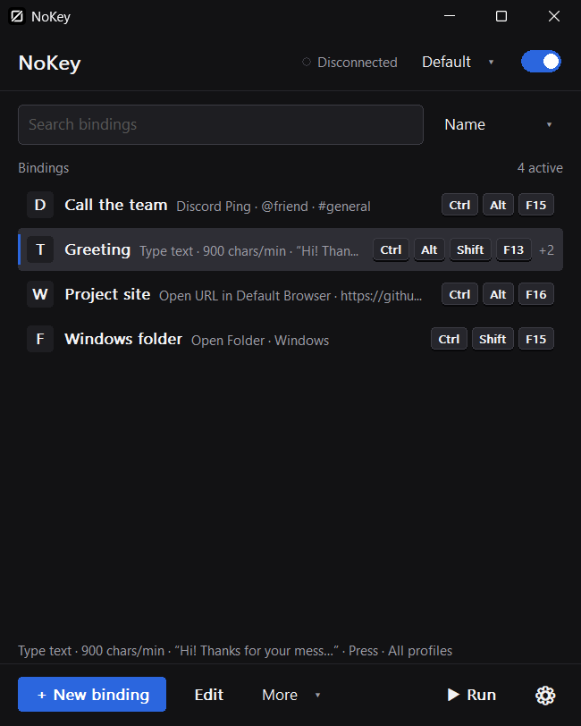
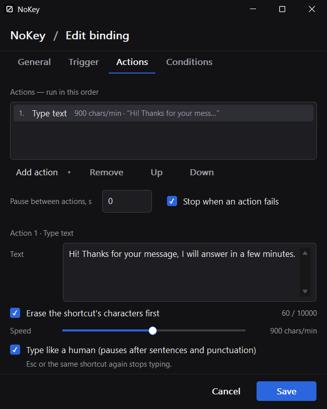
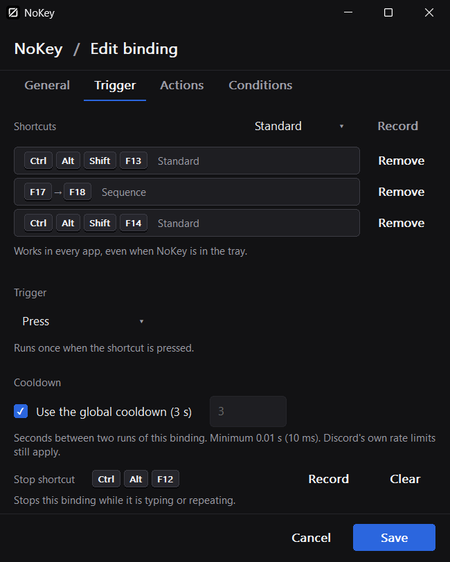
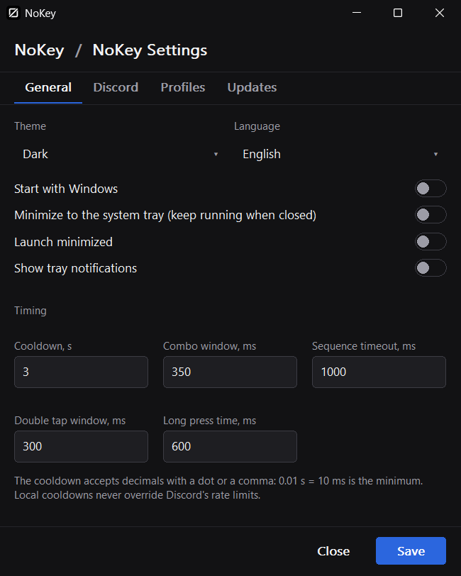
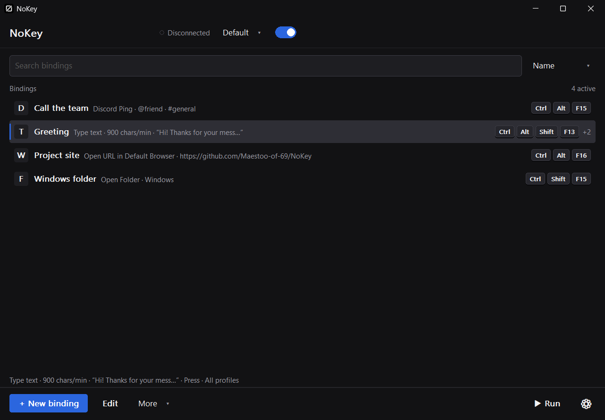

# NoKey

**Маленький нативный менеджер горячих клавиш для Windows.** Нажали сочетание, и
NoKey печатает заготовленный текст, упоминает человека в Discord, открывает
программу, файл, папку или сайт — или делает несколько таких действий подряд.

[English](README.md) · **Русский**

[**⬇ Скачать NoKey.exe**](https://github.com/Maestoo-of-69/NoKey/releases/latest/download/NoKey.exe)
· [Что нового в 1.0](https://github.com/Maestoo-of-69/NoKey/releases/tag/v1.0.0)
· [Все версии](https://github.com/Maestoo-of-69/NoKey/releases)

Windows 10 / 11, 64 бита. macOS и Linux пока не поддерживаются.

<p>
  
  
</p>

## Почему NoKey

- **Один переносимый файл** меньше 1 МБ. Без установщика, Electron, WebView и
  .NET: только Rust и Win32.
- **Тихий.** Живёт в трее, реагирует на события, а не опрашивает систему; без
  телеметрии и облаков.
- **Одно окно.** Открывается узким, растягивается и разворачивается на весь
  экран, и все страницы подстраиваются.
- **5 тем и 4 языка** интерфейса, включая иврит с зеркальной раскладкой.

## Быстрый старт

1. Скачайте `NoKey.exe` и положите в любую папку, например `C:\Tools\NoKey\`.
2. Запустите двойным щелчком. Файл не подписан сертификатом, поэтому Windows
   может предупредить:
   - **SmartScreen** («Система Windows защитила ваш компьютер»): **Подробнее →
     Выполнить в любом случае**.
   - **Интеллектуальное управление приложениями** может заблокировать без такой
     кнопки. Тогда соберите программу сами (см. [Сборка](#сборка-и-проверки))
     или отключите эту защиту.
3. NoKey появится в трее (значок `^` рядом с часами). Дважды щёлкните по нему,
   нажмите **+ Новый бинд**, запишите сочетание, выберите действие и сохраните.
4. Для упоминаний в Discord сначала нужен свой бот: [SETUP.md](SETUP.md)
   (на английском).

Проверить, что файл скачался без искажений (PowerShell, в папке загрузки),
сравнив с
[`NoKey.exe.sha256`](https://github.com/Maestoo-of-69/NoKey/releases/latest/download/NoKey.exe.sha256):

```powershell
(Get-FileHash .\NoKey.exe -Algorithm SHA256).Hash
```

**Обновление:** Настройки → Обновления → проверить, или просто замените файл;
настройки сохранятся. **Удаление:** значок в трее → **Выход**, затем удалите
`NoKey.exe` и папку `%APPDATA%\NoKey`.

## Действия

| Действие | Что делает |
|----------|------------|
| **Напечатать текст** | Печатает ваш текст в активное окно с выбранной скоростью. |
| **Пинг в Discord** | Отправляет одно сообщение `<@пользователь>` через вашего бота. Уведомление получает только он, никогда `@everyone`, `@here` или роли. |
| **Открыть приложение** | `.exe` / `.lnk` или ярлык игры `.url`, например `steam://rungameid/570`. Командные оболочки и обработчики скриптов запрещены. |
| **Открыть файл / папку** | Программы и скрипты как «файлы» не открываются. |
| **Открыть сайт** | Только `http(s)://`, в браузере по умолчанию. |

В одном бинде до **10 действий** по порядку, с паузой между ними и остановкой при
ошибке. Команды оболочки не выполняются.

### Напечатать текст

- До 10 000 символов, от **30 до 30 000 букв в минуту**.
- **Как человек:** неровный ритм и паузы после знаков, предложений и строк. У пауз
  есть минимальная длина, поэтому на высоких скоростях этот режим заметно
  медленнее настройки.
- **Стирать символы хоткея** (включено): сочетание вроде `1 → 2 → 3` тоже
  печатается в программу, поэтому NoKey сначала шлёт столько же Backspace. Работает
  на первом действии бинда, запущенного сочетанием.
- Ждёт, пока отпустите Ctrl / Alt / Shift / Win. **Останавливается** по Esc,
  повторному нажатию того же сочетания, своему хоткею остановки,
  Ctrl + Alt + Pause или при переключении окна.
- Ограничения: на высокой скорости символы уходят пачками, и некоторые программы
  могут их терять; долго удерживаемые клавиши с автоповтором напечатают больше,
  чем сотрётся; повторное нажатие для остановки оставит свои символы в тексте.
  В программы, запущенные от администратора, Windows не даёт печатать, если сам
  NoKey запущен без этих прав.

## Сочетания и срабатывание

<p>
  
  
</p>

- **Обычное** (`Ctrl + Q`), **одновременное** (`A + S`) и **последовательность**
  (`A → B`). До 3 сочетаний на бинд; приоритет 0–9 решает, кто сработает, если
  подходят несколько.
- Режимы: нажатие, отпускание, двойное нажатие, долгое нажатие, повтор при
  удержании, вкл/выкл повтора. Повторы ограничены (не чаще 0,1 с, не больше 1000
  раз) и запрещены для пингов и печати текста.
- **Хоткей остановки:** отдельная клавиша бинда, которую NoKey занимает только пока
  бинд печатает или повторяется.

## Контроль

- Главный выключатель в шапке и всегда действующий **Ctrl + Alt + Pause**
  отключают все бинды; ничего не удаляется.
- Профили, условия (программа, заголовок окна, не в полноэкранных), задержка
  между запусками, пауза бинда на 15 минут, час или до перезапуска.



## Файлы и приватность

| Что | Где |
|-----|-----|
| Настройки и бинды (вместе с текстами для печати) | `%APPDATA%\NoKey\config.json` |
| Токен бота | `%APPDATA%\NoKey\token.bin`, зашифрован Windows DPAPI, нигде не показывается |
| Скачанные обновления | `%LOCALAPPDATA%\NoKey\update\` |

`config.json` — обычный текстовый файл: не кладите пароли в тексты для печати.
Перехватчик клавиатуры держит нажатия только в памяти, чтобы узнавать сочетания.
В сеть NoKey ходит в Discord (если вы им пользуетесь) и на GitHub (проверка
обновлений).

## Сборка и проверки

Нужны Rust stable (MSVC) и Visual Studio Build Tools с Windows SDK.

```powershell
cargo build --release      # → target\release\NoKey.exe
cargo test
cargo clippy --all-targets
```

Тесты горячих клавиш нажимают F21–F24, поэтому во время них держите впереди обычное
окно (не запущенное от администратора). Подробнее об устройстве — в
[README.md](README.md) и [docs/DESIGN.md](docs/DESIGN.md).
